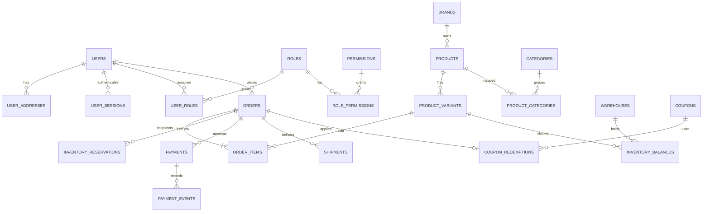

# Thiết kế database giai đoạn 1 — PostgreSQL

Thiết kế dựa trên bản đề xuất người dùng cung cấp; không phải schema nội bộ được truy cập từ AVAKids. Đã triển khai PostgreSQL 17.11: **34 bảng nghiệp vụ và 1 bảng migration**. DDL đầy đủ ở `db/migrations/001_core.sql`; hợp đồng service ở `db/schema-contract.md`.

## Quyết định kỹ thuật

- Tiền dùng BIGINT nguyên VND; tránh sai số float và không cần phần thập phân khi chỉ bán bằng VND. Không dùng tiền client gửi để tạo đơn.
- Tên cột snake_case, timestamp có múi giờ; ID nội bộ bigint identity.
- `product_variants.id` giữ ID cũ của JSON để giỏ/yêu thích không trỏ nhầm SKU. `orders.order_number` giữ mã JL cũ; FK dùng `orders.id` nội bộ mới.
- `products` là sản phẩm cha; chỉ các quy cách đúng cùng dòng mới được ghép. Không ghép tùy tiện theo type.
- Đơn và order_items giữ snapshot người nhận, tên, SKU, ảnh, đơn giá và tổng tại lúc đặt. Sửa giá hôm nay không đổi đơn hôm qua.
- Bật FK thật, CHECK tồn/tổng/số lượng, UNIQUE SKU/mã đơn/idempotency/session hash và index quan hệ. Không hard-delete SKU đã có đơn.
- Chỉ dùng một mã ưu đãi trên mỗi đơn. Kiểm lượt dùng và ghi redemption trong transaction đặt đơn.

## Quan hệ cốt lõi

## Luồng tồn và xử lý đơn

`available = on_hand - reserved`, chỉ tính các kho normal đang active. Tạo đơn khóa các dòng tồn theo thứ tự SKU/kho rồi tăng reserved. Xác nhận/chuẩn bị chưa trừ thực có. Hủy trước khi xuất giao nhả reserved; xuất giao giảm cả on_hand lẫn reserved. Giao xong không tự coi là đã thu tiền: quản trị ghi nhận COD riêng, có payment_event và audit. Kho hư hỏng không cộng vào tồn bán.

Trạng thái: `pending → confirmed → processing → shipped → delivered`; có thể hủy ở pending/confirmed/processing. Không chuyển ngược hoặc hủy đơn đã xuất trong giai đoạn này; nghiệp vụ hoàn trả ở giai đoạn 2.

## Xác thực và phân quyền

Mật khẩu bcrypt 12 vòng; session cookie HttpOnly/SameSite=Lax, token gốc không lưu trong database. Phiên 7 ngày có thể thu hồi, mutation tài khoản/quản trị cần CSRF token. Đăng ký chỉ được vai trò customer. Admin tạo rõ ràng bằng `npm run admin:create`, không có mật khẩu mặc định. Quyền: catalog.manage, orders.manage, inventory.manage, users.manage, audit.read; giao diện chỉ là phần hiển thị, server kiểm quyền độc lập. Quyền users.manage được dự phòng trong model, chưa có màn hình quản lý cấp quyền tùy ý.

## Danh mục bảng, cột và khóa

Bảng sau sinh từ metadata PostgreSQL của migration đã chạy trên schema tạm. `NOT NULL` là bắt buộc; `identity` là ID tự sinh. PK/FK/UNIQUE được liệt kê ngay dưới mỗi bảng. CHECK và partial index xem trong DDL để giữ nguyên biểu thức chính xác.

### attribute_values

Các giá trị của thuộc tính.

| Cột            | Kiểu PostgreSQL | Bắt buộc / mặc định |
| -------------- | --------------- | ------------------- |
| `id`           | `int8`          | NOT NULL; identity  |
| `attribute_id` | `int8`          | NOT NULL            |
| `value`        | `text`          | NOT NULL            |

- `FOREIGN KEY (attribute_id) REFERENCES attributes(id) ON DELETE RESTRICT`
- `PRIMARY KEY (id)`
- `UNIQUE (attribute_id, value)`

### attributes

Loại thuộc tính như quy cách, độ tuổi.

| Cột    | Kiểu PostgreSQL | Bắt buộc / mặc định |
| ------ | --------------- | ------------------- |
| `id`   | `int8`          | NOT NULL; identity  |
| `name` | `text`          | NOT NULL            |
| `code` | `text`          | NOT NULL            |

- `PRIMARY KEY (id)`
- `UNIQUE (code)`

### audit_logs

Nhật ký thao tác quản trị và nghiệp vụ.

| Cột           | Kiểu PostgreSQL | Bắt buộc / mặc định           |
| ------------- | --------------- | ----------------------------- |
| `id`          | `int8`          | NOT NULL; identity            |
| `actor_id`    | `int8`          | Cho phép NULL                 |
| `action`      | `text`          | NOT NULL                      |
| `entity_type` | `text`          | NOT NULL                      |
| `entity_id`   | `text`          | Cho phép NULL                 |
| `metadata`    | `jsonb`         | NOT NULL; `'{}'::jsonb`       |
| `created_at`  | `timestamptz`   | NOT NULL; `CURRENT_TIMESTAMP` |

- `FOREIGN KEY (actor_id) REFERENCES users(id) ON DELETE RESTRICT`
- `PRIMARY KEY (id)`

### brands

Thương hiệu sản phẩm.

| Cột           | Kiểu PostgreSQL | Bắt buộc / mặc định  |
| ------------- | --------------- | -------------------- |
| `id`          | `int8`          | NOT NULL; identity   |
| `name`        | `text`          | NOT NULL             |
| `logo_url`    | `text`          | Cho phép NULL        |
| `description` | `text`          | NOT NULL; `''::text` |

- `PRIMARY KEY (id)`
- `UNIQUE (name)`

### cart_items

Từng SKU và số lượng trong giỏ, chưa giữ tồn.

| Cột          | Kiểu PostgreSQL | Bắt buộc / mặc định |
| ------------ | --------------- | ------------------- |
| `id`         | `int8`          | NOT NULL; identity  |
| `cart_id`    | `int8`          | NOT NULL            |
| `variant_id` | `int8`          | NOT NULL            |
| `quantity`   | `int4`          | NOT NULL            |

- `FOREIGN KEY (cart_id) REFERENCES carts(id) ON DELETE RESTRICT`
- `FOREIGN KEY (variant_id) REFERENCES product_variants(id) ON DELETE RESTRICT`
- `PRIMARY KEY (id)`
- `UNIQUE (cart_id, variant_id)`

### carts

Giỏ của tài khoản hoặc phiên; một giỏ active cho mỗi chủ sở hữu.

| Cột          | Kiểu PostgreSQL | Bắt buộc / mặc định           |
| ------------ | --------------- | ----------------------------- |
| `id`         | `int8`          | NOT NULL; identity            |
| `user_id`    | `int8`          | Cho phép NULL                 |
| `session_id` | `text`          | Cho phép NULL                 |
| `status`     | `text`          | NOT NULL; `'active'::text`    |
| `created_at` | `timestamptz`   | NOT NULL; `CURRENT_TIMESTAMP` |
| `updated_at` | `timestamptz`   | NOT NULL; `CURRENT_TIMESTAMP` |

- `FOREIGN KEY (user_id) REFERENCES users(id) ON DELETE RESTRICT`
- `PRIMARY KEY (id)`

### categories

Danh mục phân cấp qua parent_id.

| Cột          | Kiểu PostgreSQL | Bắt buộc / mặc định        |
| ------------ | --------------- | -------------------------- |
| `id`         | `int8`          | NOT NULL; identity         |
| `parent_id`  | `int8`          | Cho phép NULL              |
| `name`       | `text`          | NOT NULL                   |
| `slug`       | `text`          | NOT NULL                   |
| `sort_order` | `int4`          | NOT NULL; `0`              |
| `status`     | `text`          | NOT NULL; `'active'::text` |

- `FOREIGN KEY (parent_id) REFERENCES categories(id) ON DELETE RESTRICT`
- `PRIMARY KEY (id)`
- `UNIQUE (slug)`

### coupon_redemptions

Lượt dùng mã gắn với đơn; một mã trên mỗi đơn.

| Cột         | Kiểu PostgreSQL | Bắt buộc / mặc định           |
| ----------- | --------------- | ----------------------------- |
| `id`        | `int8`          | NOT NULL; identity            |
| `coupon_id` | `int8`          | NOT NULL                      |
| `user_id`   | `int8`          | Cho phép NULL                 |
| `order_id`  | `int8`          | NOT NULL                      |
| `used_at`   | `timestamptz`   | NOT NULL; `CURRENT_TIMESTAMP` |

- `FOREIGN KEY (user_id) REFERENCES users(id) ON DELETE RESTRICT`
- `FOREIGN KEY (coupon_id) REFERENCES coupons(id) ON DELETE RESTRICT`
- `FOREIGN KEY (order_id) REFERENCES orders(id) ON DELETE RESTRICT`
- `PRIMARY KEY (id)`
- `UNIQUE (order_id)`

### coupons

Mã, thời hạn và giới hạn lượt sử dụng.

| Cột            | Kiểu PostgreSQL | Bắt buộc / mặc định        |
| -------------- | --------------- | -------------------------- |
| `id`           | `int8`          | NOT NULL; identity         |
| `code`         | `text`          | NOT NULL                   |
| `promotion_id` | `int8`          | NOT NULL                   |
| `usage_limit`  | `int4`          | Cho phép NULL              |
| `used_count`   | `int4`          | NOT NULL; `0`              |
| `expires_at`   | `timestamptz`   | Cho phép NULL              |
| `status`       | `text`          | NOT NULL; `'active'::text` |

- `FOREIGN KEY (promotion_id) REFERENCES promotions(id) ON DELETE RESTRICT`
- `PRIMARY KEY (id)`
- `UNIQUE (code)`

### inventory_balances

Tồn thực có và đang giữ, theo từng cặp kho/SKU.

| Cột            | Kiểu PostgreSQL | Bắt buộc / mặc định           |
| -------------- | --------------- | ----------------------------- |
| `warehouse_id` | `int8`          | NOT NULL                      |
| `variant_id`   | `int8`          | NOT NULL                      |
| `on_hand`      | `int4`          | NOT NULL; `0`                 |
| `reserved`     | `int4`          | NOT NULL; `0`                 |
| `updated_at`   | `timestamptz`   | NOT NULL; `CURRENT_TIMESTAMP` |

- `FOREIGN KEY (warehouse_id) REFERENCES warehouses(id) ON DELETE RESTRICT`
- `FOREIGN KEY (variant_id) REFERENCES product_variants(id) ON DELETE RESTRICT`
- `PRIMARY KEY (warehouse_id, variant_id)`

### inventory_movements

Sổ biến động tăng/giảm thực có và giữ chỗ.

| Cột               | Kiểu PostgreSQL | Bắt buộc / mặc định           |
| ----------------- | --------------- | ----------------------------- |
| `id`              | `int8`          | NOT NULL; identity            |
| `warehouse_id`    | `int8`          | NOT NULL                      |
| `variant_id`      | `int8`          | NOT NULL                      |
| `quantity_change` | `int4`          | NOT NULL                      |
| `reserved_change` | `int4`          | NOT NULL; `0`                 |
| `movement_type`   | `text`          | NOT NULL                      |
| `reference_type`  | `text`          | Cho phép NULL                 |
| `reference_id`    | `text`          | Cho phép NULL                 |
| `actor_id`        | `int8`          | Cho phép NULL                 |
| `reason`          | `text`          | NOT NULL; `''::text`          |
| `created_at`      | `timestamptz`   | NOT NULL; `CURRENT_TIMESTAMP` |

- `FOREIGN KEY (variant_id) REFERENCES product_variants(id) ON DELETE RESTRICT`
- `FOREIGN KEY (warehouse_id) REFERENCES warehouses(id) ON DELETE RESTRICT`
- `FOREIGN KEY (actor_id) REFERENCES users(id) ON DELETE RESTRICT`
- `PRIMARY KEY (id)`

### inventory_reservations

Phần giữ tồn cho từng đơn/SKU/kho.

| Cột            | Kiểu PostgreSQL | Bắt buộc / mặc định           |
| -------------- | --------------- | ----------------------------- |
| `id`           | `int8`          | NOT NULL; identity            |
| `order_id`     | `int8`          | NOT NULL                      |
| `variant_id`   | `int8`          | NOT NULL                      |
| `warehouse_id` | `int8`          | NOT NULL                      |
| `quantity`     | `int4`          | NOT NULL                      |
| `status`       | `text`          | NOT NULL; `'active'::text`    |
| `created_at`   | `timestamptz`   | NOT NULL; `CURRENT_TIMESTAMP` |
| `updated_at`   | `timestamptz`   | NOT NULL; `CURRENT_TIMESTAMP` |

- `FOREIGN KEY (warehouse_id) REFERENCES warehouses(id) ON DELETE RESTRICT`
- `FOREIGN KEY (variant_id) REFERENCES product_variants(id) ON DELETE RESTRICT`
- `FOREIGN KEY (order_id) REFERENCES orders(id) ON DELETE RESTRICT`
- `PRIMARY KEY (id)`
- `UNIQUE (order_id, variant_id, warehouse_id)`

### legacy_imports

Nhật ký nhập SQLite một lần; không chứa bản sao dữ liệu khách hàng.

| Cột           | Kiểu PostgreSQL | Bắt buộc / mặc định           |
| ------------- | --------------- | ----------------------------- |
| `source_key`  | `text`          | NOT NULL                      |
| `imported_at` | `timestamptz`   | NOT NULL; `CURRENT_TIMESTAMP` |
| `summary`     | `jsonb`         | NOT NULL; `'{}'::jsonb`       |

- `PRIMARY KEY (source_key)`

### order_items

Từng dòng hàng với tên/SKU/ảnh/giá lúc mua.

| Cột              | Kiểu PostgreSQL | Bắt buộc / mặc định  |
| ---------------- | --------------- | -------------------- |
| `id`             | `int8`          | NOT NULL; identity   |
| `order_id`       | `int8`          | NOT NULL             |
| `variant_id`     | `int8`          | NOT NULL             |
| `sku_snapshot`   | `text`          | NOT NULL             |
| `name_snapshot`  | `text`          | NOT NULL             |
| `image_snapshot` | `text`          | NOT NULL; `''::text` |
| `quantity`       | `int4`          | NOT NULL             |
| `unit_price`     | `int8`          | NOT NULL             |
| `line_total`     | `int8`          | NOT NULL             |

- `FOREIGN KEY (order_id) REFERENCES orders(id) ON DELETE RESTRICT`
- `FOREIGN KEY (variant_id) REFERENCES product_variants(id) ON DELETE RESTRICT`
- `PRIMARY KEY (id)`

### order_status_history

Lịch sử chuyển trạng thái cùng người thao tác và ghi chú.

| Cột          | Kiểu PostgreSQL | Bắt buộc / mặc định           |
| ------------ | --------------- | ----------------------------- |
| `id`         | `int8`          | NOT NULL; identity            |
| `order_id`   | `int8`          | NOT NULL                      |
| `old_status` | `text`          | Cho phép NULL                 |
| `new_status` | `text`          | NOT NULL                      |
| `changed_by` | `int8`          | Cho phép NULL                 |
| `note`       | `text`          | NOT NULL; `''::text`          |
| `created_at` | `timestamptz`   | NOT NULL; `CURRENT_TIMESTAMP` |

- `FOREIGN KEY (order_id) REFERENCES orders(id) ON DELETE RESTRICT`
- `FOREIGN KEY (changed_by) REFERENCES users(id) ON DELETE RESTRICT`
- `PRIMARY KEY (id)`

### orders

Đơn tổng thể với người nhận, địa chỉ snapshot và các tổng tiền.

| Cột               | Kiểu PostgreSQL | Bắt buộc / mặc định           |
| ----------------- | --------------- | ----------------------------- |
| `id`              | `int8`          | NOT NULL; identity            |
| `order_number`    | `text`          | NOT NULL                      |
| `user_id`         | `int8`          | Cho phép NULL                 |
| `status`          | `text`          | NOT NULL; `'pending'::text`   |
| `recipient_name`  | `text`          | NOT NULL                      |
| `recipient_phone` | `text`          | NOT NULL                      |
| `recipient_email` | `text`          | Cho phép NULL                 |
| `address_detail`  | `text`          | NOT NULL                      |
| `province`        | `text`          | NOT NULL                      |
| `district`        | `text`          | NOT NULL                      |
| `subtotal`        | `int8`          | NOT NULL                      |
| `discount_total`  | `int8`          | NOT NULL; `0`                 |
| `shipping_fee`    | `int8`          | NOT NULL; `0`                 |
| `grand_total`     | `int8`          | NOT NULL                      |
| `coupon_code`     | `text`          | NOT NULL; `''::text`          |
| `payment_method`  | `text`          | NOT NULL; `'cod'::text`       |
| `note`            | `text`          | NOT NULL; `''::text`          |
| `access_token`    | `text`          | NOT NULL                      |
| `idempotency_key` | `text`          | NOT NULL                      |
| `fingerprint`     | `text`          | NOT NULL                      |
| `created_at`      | `timestamptz`   | NOT NULL; `CURRENT_TIMESTAMP` |
| `updated_at`      | `timestamptz`   | NOT NULL; `CURRENT_TIMESTAMP` |

- `FOREIGN KEY (user_id) REFERENCES users(id) ON DELETE RESTRICT`
- `PRIMARY KEY (id)`
- `UNIQUE (idempotency_key)`
- `UNIQUE (order_number)`

### payment_events

Sự kiện thanh toán duy nhất để tránh ghi nhận trùng.

| Cột                 | Kiểu PostgreSQL | Bắt buộc / mặc định           |
| ------------------- | --------------- | ----------------------------- |
| `id`                | `int8`          | NOT NULL; identity            |
| `payment_id`        | `int8`          | NOT NULL                      |
| `provider_event_id` | `text`          | NOT NULL                      |
| `event_type`        | `text`          | NOT NULL                      |
| `received_at`       | `timestamptz`   | NOT NULL; `CURRENT_TIMESTAMP` |
| `payload`           | `jsonb`         | NOT NULL; `'{}'::jsonb`       |

- `FOREIGN KEY (payment_id) REFERENCES payments(id) ON DELETE RESTRICT`
- `PRIMARY KEY (id)`
- `UNIQUE (provider_event_id)`

### payments

Ghi nhận thanh toán; giai đoạn này dùng COD.

| Cột          | Kiểu PostgreSQL | Bắt buộc / mặc định           |
| ------------ | --------------- | ----------------------------- |
| `id`         | `int8`          | NOT NULL; identity            |
| `order_id`   | `int8`          | NOT NULL                      |
| `provider`   | `text`          | NOT NULL; `'manual'::text`    |
| `method`     | `text`          | NOT NULL; `'cod'::text`       |
| `amount`     | `int8`          | NOT NULL                      |
| `status`     | `text`          | NOT NULL; `'pending'::text`   |
| `paid_at`    | `timestamptz`   | Cho phép NULL                 |
| `created_at` | `timestamptz`   | NOT NULL; `CURRENT_TIMESTAMP` |

- `FOREIGN KEY (order_id) REFERENCES orders(id) ON DELETE RESTRICT`
- `PRIMARY KEY (id)`

### permissions

Quyền thao tác nghiệp vụ.

| Cột           | Kiểu PostgreSQL | Bắt buộc / mặc định  |
| ------------- | --------------- | -------------------- |
| `id`          | `int8`          | NOT NULL; identity   |
| `code`        | `text`          | NOT NULL             |
| `description` | `text`          | NOT NULL; `''::text` |

- `PRIMARY KEY (id)`
- `UNIQUE (code)`

### product_categories

Quan hệ nhiều-nhiều sản phẩm/danh mục.

| Cột           | Kiểu PostgreSQL | Bắt buộc / mặc định |
| ------------- | --------------- | ------------------- |
| `product_id`  | `int8`          | NOT NULL            |
| `category_id` | `int8`          | NOT NULL            |

- `FOREIGN KEY (product_id) REFERENCES products(id) ON DELETE CASCADE`
- `FOREIGN KEY (category_id) REFERENCES categories(id) ON DELETE CASCADE`
- `PRIMARY KEY (product_id, category_id)`

### product_media

Hình/video cấp sản phẩm hoặc SKU.

| Cột          | Kiểu PostgreSQL | Bắt buộc / mặc định       |
| ------------ | --------------- | ------------------------- |
| `id`         | `int8`          | NOT NULL; identity        |
| `product_id` | `int8`          | NOT NULL                  |
| `variant_id` | `int8`          | Cho phép NULL             |
| `url`        | `text`          | NOT NULL                  |
| `media_type` | `text`          | NOT NULL; `'image'::text` |
| `sort_order` | `int4`          | NOT NULL; `0`             |

- `FOREIGN KEY (variant_id) REFERENCES product_variants(id) ON DELETE RESTRICT`
- `FOREIGN KEY (product_id) REFERENCES products(id) ON DELETE RESTRICT`
- `PRIMARY KEY (id)`

### product_specs

Thông tin kỹ thuật và đặc điểm sản phẩm.

| Cột          | Kiểu PostgreSQL | Bắt buộc / mặc định |
| ------------ | --------------- | ------------------- |
| `id`         | `int8`          | NOT NULL; identity  |
| `product_id` | `int8`          | NOT NULL            |
| `spec_name`  | `text`          | NOT NULL            |
| `spec_value` | `text`          | NOT NULL            |
| `sort_order` | `int4`          | NOT NULL; `0`       |

- `FOREIGN KEY (product_id) REFERENCES products(id) ON DELETE RESTRICT`
- `PRIMARY KEY (id)`

### product_variants

SKU bán hàng, mỗi quy cách có giá và ID riêng.

| Cột              | Kiểu PostgreSQL | Bắt buộc / mặc định           |
| ---------------- | --------------- | ----------------------------- |
| `id`             | `int8`          | NOT NULL; identity            |
| `product_id`     | `int8`          | NOT NULL                      |
| `name`           | `text`          | NOT NULL                      |
| `slug`           | `text`          | NOT NULL                      |
| `sku`            | `text`          | NOT NULL                      |
| `barcode`        | `text`          | Cho phép NULL                 |
| `price`          | `int8`          | NOT NULL                      |
| `original_price` | `int8`          | Cho phép NULL                 |
| `age`            | `text`          | NOT NULL; `''::text`          |
| `weight`         | `text`          | NOT NULL; `''::text`          |
| `type`           | `text`          | NOT NULL; `''::text`          |
| `status`         | `text`          | NOT NULL; `'active'::text`    |
| `created_at`     | `timestamptz`   | NOT NULL; `CURRENT_TIMESTAMP` |
| `updated_at`     | `timestamptz`   | NOT NULL; `CURRENT_TIMESTAMP` |

- `FOREIGN KEY (product_id) REFERENCES products(id) ON DELETE RESTRICT`
- `PRIMARY KEY (id)`
- `UNIQUE (sku)`
- `UNIQUE (slug)`

### products

Sản phẩm cha, chưa phải đơn vị trực tiếp bán.

| Cột           | Kiểu PostgreSQL | Bắt buộc / mặc định           |
| ------------- | --------------- | ----------------------------- |
| `id`          | `int8`          | NOT NULL; identity            |
| `brand_id`    | `int8`          | Cho phép NULL                 |
| `name`        | `text`          | NOT NULL                      |
| `slug`        | `text`          | NOT NULL                      |
| `description` | `text`          | NOT NULL; `''::text`          |
| `status`      | `text`          | NOT NULL; `'active'::text`    |
| `created_at`  | `timestamptz`   | NOT NULL; `CURRENT_TIMESTAMP` |
| `updated_at`  | `timestamptz`   | NOT NULL; `CURRENT_TIMESTAMP` |

- `FOREIGN KEY (brand_id) REFERENCES brands(id) ON DELETE RESTRICT`
- `PRIMARY KEY (id)`
- `UNIQUE (slug)`

### promotions

Điều kiện và kiểu giảm giá.

| Cột                | Kiểu PostgreSQL | Bắt buộc / mặc định        |
| ------------------ | --------------- | -------------------------- |
| `id`               | `int8`          | NOT NULL; identity         |
| `name`             | `text`          | NOT NULL                   |
| `discount_type`    | `text`          | NOT NULL                   |
| `discount_value`   | `int8`          | NOT NULL; `0`              |
| `minimum_order`    | `int8`          | NOT NULL; `0`              |
| `maximum_discount` | `int8`          | Cho phép NULL              |
| `start_at`         | `timestamptz`   | Cho phép NULL              |
| `end_at`           | `timestamptz`   | Cho phép NULL              |
| `status`           | `text`          | NOT NULL; `'active'::text` |
| `priority`         | `int4`          | NOT NULL; `0`              |
| `stackable`        | `bool`          | NOT NULL; `false`          |

- `PRIMARY KEY (id)`

### role_permissions

Gán các quyền cho từng vai trò.

| Cột             | Kiểu PostgreSQL | Bắt buộc / mặc định |
| --------------- | --------------- | ------------------- |
| `role_id`       | `int8`          | NOT NULL            |
| `permission_id` | `int8`          | NOT NULL            |

- `FOREIGN KEY (role_id) REFERENCES roles(id) ON DELETE CASCADE`
- `FOREIGN KEY (permission_id) REFERENCES permissions(id) ON DELETE CASCADE`
- `PRIMARY KEY (role_id, permission_id)`

### roles

Vai trò admin/customer.

| Cột           | Kiểu PostgreSQL | Bắt buộc / mặc định  |
| ------------- | --------------- | -------------------- |
| `id`          | `int8`          | NOT NULL; identity   |
| `name`        | `text`          | NOT NULL             |
| `description` | `text`          | NOT NULL; `''::text` |

- `PRIMARY KEY (id)`
- `UNIQUE (name)`

### schema_migrations

Phiên bản và checksum của migration.

| Cột          | Kiểu PostgreSQL | Bắt buộc / mặc định           |
| ------------ | --------------- | ----------------------------- |
| `version`    | `text`          | NOT NULL                      |
| `checksum`   | `text`          | NOT NULL                      |
| `applied_at` | `timestamptz`   | NOT NULL; `CURRENT_TIMESTAMP` |

- `PRIMARY KEY (version)`

### shipments

Trạng thái giao hàng nội bộ; chưa kết nối hãng vận chuyển.

| Cột               | Kiểu PostgreSQL | Bắt buộc / mặc định           |
| ----------------- | --------------- | ----------------------------- |
| `id`              | `int8`          | NOT NULL; identity            |
| `order_id`        | `int8`          | NOT NULL                      |
| `carrier`         | `text`          | Cho phép NULL                 |
| `tracking_number` | `text`          | Cho phép NULL                 |
| `status`          | `text`          | NOT NULL; `'pending'::text`   |
| `created_at`      | `timestamptz`   | NOT NULL; `CURRENT_TIMESTAMP` |
| `updated_at`      | `timestamptz`   | NOT NULL; `CURRENT_TIMESTAMP` |

- `FOREIGN KEY (order_id) REFERENCES orders(id) ON DELETE RESTRICT`
- `PRIMARY KEY (id)`

### user_addresses

Địa chỉ thuộc từng tài khoản; tối đa một địa chỉ mặc định.

| Cột              | Kiểu PostgreSQL | Bắt buộc / mặc định           |
| ---------------- | --------------- | ----------------------------- |
| `id`             | `int8`          | NOT NULL; identity            |
| `user_id`        | `int8`          | NOT NULL                      |
| `recipient_name` | `text`          | NOT NULL                      |
| `phone`          | `text`          | NOT NULL                      |
| `province_code`  | `text`          | Cho phép NULL                 |
| `ward_code`      | `text`          | Cho phép NULL                 |
| `province`       | `text`          | NOT NULL; `''::text`          |
| `district`       | `text`          | NOT NULL; `''::text`          |
| `address_detail` | `text`          | NOT NULL                      |
| `is_default`     | `bool`          | NOT NULL; `false`             |
| `created_at`     | `timestamptz`   | NOT NULL; `CURRENT_TIMESTAMP` |
| `updated_at`     | `timestamptz`   | NOT NULL; `CURRENT_TIMESTAMP` |

- `FOREIGN KEY (user_id) REFERENCES users(id) ON DELETE RESTRICT`
- `PRIMARY KEY (id)`

### user_roles

Gán nhiều vai trò cho một tài khoản.

| Cột       | Kiểu PostgreSQL | Bắt buộc / mặc định |
| --------- | --------------- | ------------------- |
| `user_id` | `int8`          | NOT NULL            |
| `role_id` | `int8`          | NOT NULL            |

- `FOREIGN KEY (user_id) REFERENCES users(id) ON DELETE CASCADE`
- `FOREIGN KEY (role_id) REFERENCES roles(id) ON DELETE CASCADE`
- `PRIMARY KEY (user_id, role_id)`

### user_sessions

Phiên đăng nhập, chỉ lưu hash token; có thời hạn và khả năng thu hồi.

| Cột          | Kiểu PostgreSQL | Bắt buộc / mặc định           |
| ------------ | --------------- | ----------------------------- |
| `id`         | `int8`          | NOT NULL; identity            |
| `user_id`    | `int8`          | NOT NULL                      |
| `token_hash` | `text`          | NOT NULL                      |
| `csrf_token` | `text`          | NOT NULL                      |
| `expires_at` | `timestamptz`   | NOT NULL                      |
| `revoked_at` | `timestamptz`   | Cho phép NULL                 |
| `created_at` | `timestamptz`   | NOT NULL; `CURRENT_TIMESTAMP` |

- `FOREIGN KEY (user_id) REFERENCES users(id) ON DELETE RESTRICT`
- `PRIMARY KEY (id)`
- `UNIQUE (token_hash)`

### users

Tài khoản dùng chung cho khách và nhân viên.

| Cột             | Kiểu PostgreSQL | Bắt buộc / mặc định           |
| --------------- | --------------- | ----------------------------- |
| `id`            | `int8`          | NOT NULL; identity            |
| `full_name`     | `text`          | NOT NULL                      |
| `phone`         | `text`          | NOT NULL                      |
| `email`         | `text`          | Cho phép NULL                 |
| `password_hash` | `text`          | NOT NULL                      |
| `status`        | `text`          | NOT NULL; `'active'::text`    |
| `created_at`    | `timestamptz`   | NOT NULL; `CURRENT_TIMESTAMP` |
| `updated_at`    | `timestamptz`   | NOT NULL; `CURRENT_TIMESTAMP` |

- `PRIMARY KEY (id)`
- `UNIQUE (email)`
- `UNIQUE (phone)`

### variant_attribute_values

Gán giá trị thuộc tính cho SKU.

| Cột                  | Kiểu PostgreSQL | Bắt buộc / mặc định |
| -------------------- | --------------- | ------------------- |
| `variant_id`         | `int8`          | NOT NULL            |
| `attribute_value_id` | `int8`          | NOT NULL            |

- `FOREIGN KEY (attribute_value_id) REFERENCES attribute_values(id) ON DELETE CASCADE`
- `FOREIGN KEY (variant_id) REFERENCES product_variants(id) ON DELETE CASCADE`
- `PRIMARY KEY (variant_id, attribute_value_id)`

### warehouses

Kho thông thường hoặc kho hư hỏng.

| Cột      | Kiểu PostgreSQL | Bắt buộc / mặc định        |
| -------- | --------------- | -------------------------- |
| `id`     | `int8`          | NOT NULL; identity         |
| `name`   | `text`          | NOT NULL                   |
| `type`   | `text`          | NOT NULL; `'normal'::text` |
| `status` | `text`          | NOT NULL; `'active'::text` |

- `PRIMARY KEY (id)`

## Chuyển dữ liệu và vận hành

`db/import-legacy.mjs` sao lưu SQLite nhất quán gồm WAL bằng API backup, sau đó nhập bằng một transaction PostgreSQL và ghi legacy_imports để không nhập lại. Giữ mã đơn, token tra cứu cũ, fingerprint/idempotency và snapshot giá; tồn khả dụng mới phải bằng tồn SQLite cũ. Với đơn cũ chưa xuất, on_hand = tồn cũ + tổng giữ cho đơn, reserved = tổng giữ. File SQLite không xóa. Lần chuyển live cần ngừng đúng tiến trình 3001 trước khi lấy bản nhập cuối; không tác động 3000.

Catalog JSON chỉ seed ban đầu, không phải nguồn giá/tồn khi chạy. API đọc từ PostgreSQL; seed chạy lại không ghi đè giá/tồn đã vận hành. Database cục bộ ở /workspace/.postgres/data, dùng Unix socket với xác thực OS peer, TCP tắt. Triển khai khác dùng DATABASE_URL của PostgreSQL đã cấp phát; bật cookie Secure trên HTTPS.

Chưa triển khai: cổng thanh toán, OTP/SMS, vận chuyển thực, hoàn hàng, quản lý lô/hạn dùng, livestream, tích điểm, đồng bộ sàn và dịch tự động. Không tạo bảng trống để coi các tính năng này đã hoạt động.
