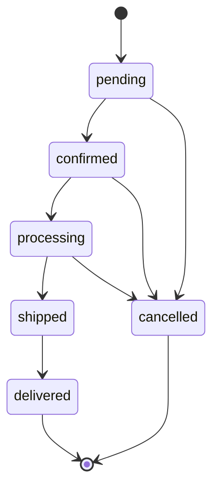
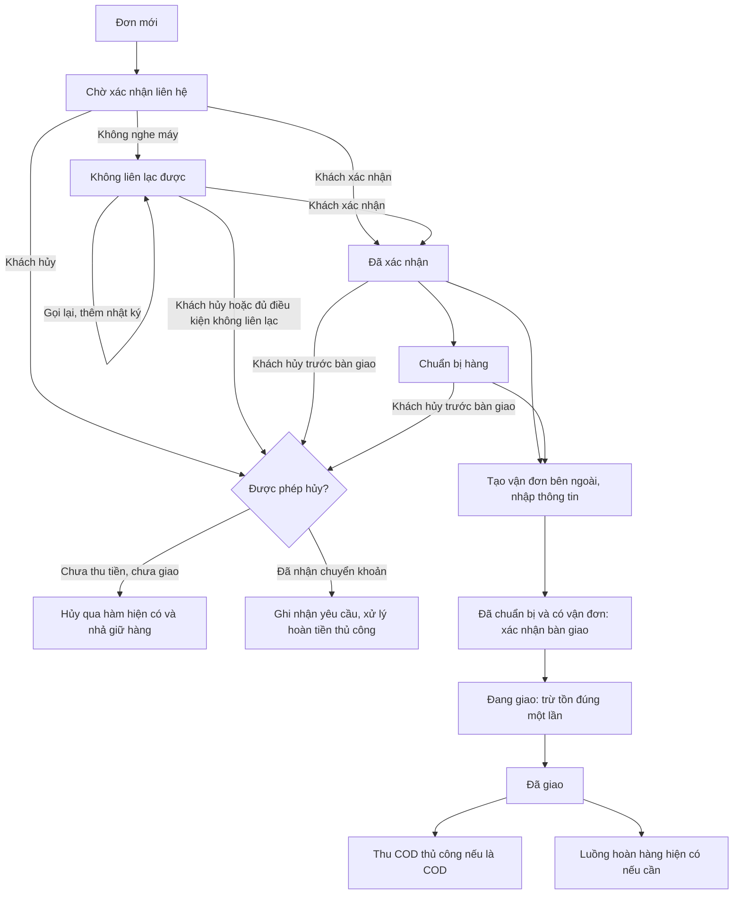

# Kế hoạch: gọi xác nhận và nhập vận đơn thủ công

**Trạng thái: Bước 1 — chờ chủ dự án duyệt. Chưa triển khai Bước 2.**

Chỉ khảo sát source và viết tài liệu này. Không thay đổi code, cấu hình môi trường, migration hoặc dữ liệu; không gọi API hãng vận chuyển hay gửi Telegram.

## 1. Phiên bản được đọc

- Thư mục: `/workspace/Jielien`.
- Nhánh lập kế hoạch: `docs/manual-order-flow-plan`, tạo từ trạng thái làm việc của `feat/manual-bank-reconciliation-expiry`.
- HEAD: `7aa3b1ed9bbb79ab903d2067ab336372ab332ac7`.
- Working tree đang chứa các thay đổi từ nhiệm vụ Sentry, cấu hình ngân hàng và đối soát/hết hạn trước đó, chưa commit. Nhận xét ở đây dựa trên **source hiện có trong working tree**, gồm migration 020, không chỉ bản HEAD.
- Không có `.codegraph/` trong project ở lần khảo sát trước; lần này đọc trực tiếp service, handler, schema và renderer liên quan. Chưa xác nhận trạng thái triển khai/database trên máy chủ thật.
- Bước này không chạy test, không khởi động job và không thao tác database. Những hành vi dưới đây mới được xác nhận qua source; kiểm thử cho thay đổi mới nằm trong kế hoạch Bước 2.

## 2. Luồng đơn hiện có

Nguồn chính: `db/store.mjs:32`, `db/store.mjs:723`; bảng chuyển đổi trên Admin ở `public/admin.js:48` đang tương ứng backend.

| Mã lưu | Hiển thị hiện tại | Được chuyển tiếp sang |
|---|---|---|
| `pending` | Chờ xác nhận | `confirmed`, `cancelled` |
| `confirmed` | Đã xác nhận | `processing`, `cancelled` |
| `processing` | Đang chuẩn bị | `shipped`, `cancelled` |
| `shipped` | Đang giao | `delivered` |
| `delivered` | Đã giao | Không có bước tiếp theo trong luồng đơn |
| `cancelled` | Đã hủy | Không mở lại bằng hàm hiện tại |

`PATCH /api/admin/orders/:id/status` kiểm tra `orders.manage`, gọi `store.updateOrderStatus()` với nhân viên lấy từ session (`server.mjs:650`). Service khóa đơn, kiểm tra chuyển đổi, cập nhật history/audit và các bảng liên quan trong một transaction. Gọi lại cùng trạng thái trả đơn hiện tại, không nhả/trừ tồn lần nữa.

**Các ràng buộc phải giữ:**

| Thao tác | Hành vi thực trong source | Bằng chứng |
|---|---|---|
| Tạo đơn | Tăng `reserved`, tạo reservation `active`; chưa trừ `on_hand` | `db/store.mjs:621` |
| Xác nhận/chuẩn bị | Giữ nguyên hàng đang giữ; chưa xuất kho | `db/store.mjs:775` chỉ xử lý tồn cho shipped/cancelled |
| Chuyển `shipped` | Trừ `on_hand`, giảm `reserved`, reservation thành `consumed`, ghi movement `sale` | `db/store.mjs:775` |
| Hủy trước giao | Giảm `reserved`, không giảm `on_hand`, reservation thành `released`, ghi movement `release` | `db/store.mjs:775` |
| Hủy | Payment còn pending thành cancelled; cập nhật shipment, history và audit | `db/store.mjs:814` |
| Xuất/giao đơn chuyển khoản | Phải có payment chuyển khoản đã paid | `db/store.mjs:742` |
| Hủy đơn chuyển khoản đã paid | Bị chặn, trả `refund_required` | `db/store.mjs:757` |

Không thể dùng hủy đơn để xử lý giao thất bại sau `shipped`: luồng hiện tại không cho `shipped → cancelled`. Không bổ sung luồng này âm thầm trong nhiệm vụ mới.

## 3. Shipments hiện có: có bảng, chưa có nghiệp vụ vận đơn nhập tay

`db/migrations/001_core.sql:296` đã có:

| Trường | Ý nghĩa hiện tại |
|---|---|
| `id`, `order_id` | Liên kết với đơn; order_id có index, **không có ràng buộc duy nhất** |
| `carrier`, `tracking_number` | TEXT, cho phép NULL |
| `status` | pending / ready / processing / shipped / delivered / cancelled |
| `created_at`, `updated_at` | Mốc ghi nhận |

Mỗi đơn mới đã tự có một dòng shipment pending (`db/store.mjs:674`). Import đơn cũ cũng tạo shipment tương ứng (`db/import-legacy.mjs:262`).

Hiện shipment chỉ được cập nhật trạng thái theo đơn, **tất cả dòng có cùng order_id** (`db/store.mjs:822`): confirmed → ready; processing → processing; shipped → shipped; delivered → delivered; cancelled → cancelled.

Đọc các nơi tham chiếu shipments trong source chưa thấy API/form lưu carrier/tracking; `readOrder()` chưa đọc hoặc trả shipment (`db/store.mjs:320`). `public/app.js:408` và `public/account.js:202` chưa hiển thị hãng/mã vận đơn. Vì vậy không coi hai cột có sẵn là tính năng vận đơn đã triển khai.

## 4. Thu COD và hoàn hàng hiện có

### COD

`recordPayment()` chỉ cho ghi nhận khi **đơn đã delivered**, có payment COD; thao tác paid lặp không tạo thêm receipt. Ghi `payment_events` loại `cod.collected` và audit (`db/store.mjs:932`). API yêu cầu `payments.reconcile` (`server.mjs:682`).

Giao thành công không tự đồng nghĩa với thu được COD. Nhập vận đơn hoặc xác nhận đã gọi khách cũng không được tự ghi COD paid.

### Hoàn hàng

`lib/returns.mjs:27` chỉ tạo yêu cầu từ đơn `delivered`. Số lượng hoàn được kiểm tra theo từng dòng hàng, tính cả yêu cầu chưa bị từ chối để tránh hoàn vượt lượng đã mua.

| Thao tác | Trạng thái trước → sau | Quyền service thực sự kiểm tra |
|---|---|---|
| Tạo yêu cầu | → requested | `returns.manage` |
| Cho phép nhận | requested → authorized | `returns.manage` |
| Nhận hàng | authorized → received | `returns.manage` |
| Kiểm định | received → inspected | `returns.manage` |
| Duyệt | inspected → approved | `inventory.approve` |
| Hoàn tất | approved → completed | `inventory.approve` |
| Từ chối | Trạng thái chưa kết thúc → rejected | `inventory.approve` |

Nguồn: `lib/returns.mjs:107`. `complete` chạy lặp với yêu cầu đã completed trả kết quả cũ. Khi hoàn tất, hàng sealed vào kho normal; opened/damaged vào kho damaged; tăng tồn đúng lượng hoàn và ghi movement/audit (`lib/returns.mjs:141`).

Luồng này không đổi trạng thái đơn delivered, không dùng lại reservation của đơn đã xuất và không tự chuyển tiền hoàn cho khách. Có permission `refunds.approve` trong migration 010 nhưng **không được coi đó là API hoàn tiền đã triển khai**; service hoàn hàng hiện kiểm tra `inventory.approve` ở bước duyệt/hoàn tất.

## 5. Những phần còn thiếu và điểm cần bảo toàn

| Phần | Hiện có | Cần thêm ở Bước 2 |
|---|---|---|
| Xác nhận liên hệ | Chỉ có trạng thái đơn confirmed, chưa chứng minh đã gọi | Bước liên hệ riêng, kết quả và nhật ký thực tế |
| Không liên lạc/khách hủy | Chưa có mô hình riêng | Phân biệt gọi thất bại, yêu cầu hủy và hủy hoàn tất |
| Nhật ký cuộc gọi | Chưa thấy bảng/API | Chỉ thêm, có nhân viên/thời gian/kết quả/ghi chú |
| Vận đơn | Có hai cột hãng/mã và dòng giữ chỗ | Form/API nhập tay, danh mục hãng, link, phí thực tế, ngày gửi |
| Tra cứu cho khách | Trạng thái và thanh toán | Thông tin vận đơn công khai, không có ghi chú/nhân viên nội bộ |
| Chờ liên hệ | Chưa có bộ lọc/nhắc theo thời gian | Bộ lọc và nhắc sau 4 giờ; hủy không liên lạc mặc định tắt |

**Điểm riêng tư đã thấy qua source:** `readOrder()` trả `statusHistory.note` (`db/store.mjs:395`), trong đó note có thể là ghi chú nhân viên nhập. Các API tra cứu/đơn dùng DTO này; `stripToken()` chỉ bỏ token, không lọc note (`server.mjs:179`, `server.mjs:548`). Giao diện chưa hiện không có nghĩa API đã giấu. Bước 2 cần lọc ngay ở backend trước khi bổ sung nhật ký gọi, không chỉ ẩn bằng CSS.

`order.note` hiện là ghi chú khách nhập lúc đặt, khác với ghi chú cuộc gọi/ghi chú xử lý nội bộ. Không trộn các loại này.

## 6. Thiết kế đề xuất: thêm bước liên hệ, giữ nguyên mã trạng thái đơn

**Đề xuất để duyệt:** không thay sáu mã `orders.status`. Thêm trạng thái liên hệ riêng cho đơn theo quy trình mới, với nhãn tiếng Việt bên ngoài:

| Bước liên hệ đề xuất | Trạng thái đơn đi kèm | Xử lý |
|---|---|---|
| Chờ xác nhận liên hệ | pending | Giữ hàng như hiện tại |
| Không liên lạc được | pending | Thêm lần gọi thất bại; tiếp tục giữ hàng và chờ gọi lại |
| Đã xác nhận | confirmed, rồi processing/shipped/delivered | Có nhật ký xác nhận thật; không lùi lại chờ liên hệ |
| Khách hủy | cancelled nếu được phép hủy | Nhật ký kết quả + gọi đúng hàm hủy hiện có |
| Khách yêu cầu hủy, cần xử lý tiền | Giữ trạng thái đơn hiện có | Nếu chuyển khoản đã paid, ghi nhận yêu cầu nhưng không vượt qua guard hoàn tiền |

Không dùng `orders.status='unreachable'`: cách đó sẽ làm các bảng chuyển đổi, bộ lọc, constraint, expiry, COD và hoàn hàng hiện tại phải hiểu một mã mới không cần thiết.

### Một đầu mối thay đổi quy trình

Đề xuất một service `transitionOrder({orderNumber, action, actor, data, expectedVersion, requestKey})` cho các thao tác liên hệ, trạng thái đơn, tạo/sửa thông tin vận đơn và bàn giao. Đây là đầu mối kiểm quyền, khóa đơn, kiểm tra điều kiện, cập nhật và ghi audit.

Các API trạng thái cũ, API mới và job đều phải đi qua đầu mối này hoặc wrapper tương thích; không để API `/status` đi vòng để xác nhận/xuất đơn mới chưa liên hệ.

Phần nhả tồn/xuất kho tiếp tục dùng logic hiện có của `updateOrderStatus()` trên **cùng transaction/kết nối**. Không viết một bản hủy đơn hoặc một đoạn trừ tồn thứ hai. Wrapper tránh transaction lồng nhau; thứ tự khóa và chỉ xử lý reservation active được giữ nguyên.

Thu COD, đối soát chuyển khoản và hoàn hàng vẫn là service nghiệp vụ riêng: không đổi chúng thành bước tự động của service liên hệ.

### Nhật ký chỉ thêm

Đề xuất bảng mới `order_contact_attempts`: mã đơn, thời gian do server ghi, nhân viên lấy từ session, kết quả, ghi chú nội bộ có giới hạn độ dài và request key chống gửi trùng. Không tin actor/thời gian/số lần gọi do trình duyệt tự khai để tính điều kiện hủy.

Không có API sửa/xóa nhật ký; thêm bảo vệ UPDATE/DELETE ở database cho bảng nhật ký mới. Ghi sai thì thêm một dòng đính chính có tham chiếu dòng cũ. Gửi lại cùng request key không tính thêm lần gọi. Khóa đơn và phiên bản cập nhật ngăn hai nhân viên xác nhận/hủy trái nhau; khi xung đột giữ nội dung form để nhân viên tải lại, kiểm tra rồi ghi nhận đúng.

Khách hủy khi chưa thu tiền: thêm kết quả và hủy trong một transaction. Khách hủy khi đã nhận chuyển khoản: ghi **yêu cầu hủy/cần xử lý hoàn tiền**, không ghi giả rằng đã hủy/hoàn tiền. Source chưa có nghiệp vụ hoàn tiền thực tế; không tự thêm hoặc bỏ qua `refund_required` trong nhiệm vụ này.

## 7. Nhập vận đơn và thời điểm trừ tồn

- Dùng lại `shipments.carrier`, `tracking_number` để lưu snapshot tên hãng và mã vận đơn. Thêm trường nullable cho hãng cấu hình tham chiếu, link tra cứu, phí ship thực tế và ngày gửi. Phí dùng số nguyên VND không âm; NULL trên đơn cũ nghĩa là chưa biết, không tự coi là 0 đồng.
- Danh sách hãng cấu hình qua màn hình có quyền settings; tên/trạng thái bật tắt, không có API token. Hãng ngừng sử dụng không làm mất tên đã lưu trên vận đơn cũ.
- Đơn mới phải có liên hệ đã xác nhận. Đề xuất cho nhập khi đơn confirmed hoặc processing (đã xác nhận và đang chuẩn bị); không cho pending/unreachable/cancelled/shipped/delivered tạo vận đơn mới trong luồng này.
- Dùng lại dòng shipment giữ chỗ đã được tạo lúc đặt hàng. Không tạo thêm dòng mỗi lần bấm lưu. Mã request/phiên bản và khóa đơn bảo vệ gửi lặp/cùng sửa.
- Bảng hiện cho nhiều shipment/đơn: không thêm UNIQUE(order_id) cho toàn bảng, không xóa/gộp dữ liệu cũ. Luồng mới chỉ quản lý một vận đơn đang hoạt động; nếu cần ràng buộc, chỉ đặt trên các dòng được đánh dấu thuộc luồng mới. Đơn cũ có nhiều dòng giữ nguyên; cần chọn đúng dòng khi chỉnh, không ghi đè hàng loạt carrier/tracking.
- Lưu vận đơn **chưa** chuyển đơn sang shipped, chưa giảm tồn. Ngày gửi do nhân viên nhập được lưu làm thông tin vận đơn, không tự chứng minh đã bàn giao hàng.
- Nhân viên bấm **Đã bàn giao hàng** mới đi processing → shipped bằng service chung. Nếu đang confirmed thì phải qua chuẩn bị theo ma trận hiện có; không tự mở đường tắt confirmed → shipped. Gửi lặp không giảm tồn hai lần.
- Giữ guard chuyển khoản phải paid trước shipped. Theo đề xuất, có thể lưu thông tin vận đơn sau xác nhận khi tiền chưa được đối soát, nhưng chưa được xuất giao.
- Phí ship thực tế là chi phí vận chuyển, tách khỏi `orders.shipping_fee` đã chốt với khách. Không sửa grand_total, tiền COD, coupon hoặc VietQR của đơn vì nhập phí thực tế.
- Chỉ cho sửa thông tin vận đơn theo quyền và ghi audit. Chỉnh dữ liệu không được gọi lại xuất kho. Thay đổi sau bàn giao cần lý do, không tạo thêm vận đơn để tránh trừ tồn lặp; không bổ sung tách kiện/giao một phần trong nhiệm vụ này.
- Hủy trong hệ thống không hủy được vận đơn ở hãng: nhân viên phải tự hủy trên hệ thống bên ngoài khi cần. Không có API hãng vận chuyển trong thiết kế.

## 8. Đơn cũ và migration an toàn

Đề xuất migration tiếp theo sau 020, số/tên xác nhận lại khi bắt đầu Bước 2; không sửa migration đã áp dụng.

1. Thêm bảng nhật ký và metadata liên hệ/vận đơn bằng migration mới theo framework checksum/khóa hiện có. Không backfill trạng thái đơn, ghi chú, reservation hoặc payment.
2. Đánh dấu phiên bản quy trình cho **đơn mới** khi tạo. Metadata đơn cũ giữ NULL; giao diện ghi rõ “Đơn cũ — chưa có nhật ký liên hệ”, không dựng cuộc gọi hoặc xác nhận giả.
3. Legacy pending tiếp tục được đọc/xử lý theo luồng cũ. Có thao tác chủ động bắt đầu quy trình liên hệ mới, có audit; không tự áp job hủy/nhắc liên hệ mới lên toàn bộ đơn cũ.
4. Legacy confirmed/processing không bắt buộc có nhật ký gọi mà source trước đây không lưu. Có thể bổ sung vận đơn dựa trên trạng thái đã xác nhận hiện hữu, kèm audit; không cần quay về pending. Legacy shipped/delivered giữ nguyên, COD và hoàn hàng vẫn chạy.
5. Đơn theo quy trình mới bắt buộc kiểm tra liên hệ ở backend trên mọi đường chuyển trạng thái/tạo vận đơn. Nhãn trạng thái trên Admin/storefront/account được cập nhật đồng bộ.
6. Không reset dữ liệu, không tạo lại shipment/reservation/payment của đơn cũ. Test migration so sánh nguyên vẹn các trường cũ và kiểm tra chạy lại không làm thay đổi dữ liệu.

Điều này cố ý phân biệt “đã confirmed theo source cũ” với “đã có cuộc gọi xác nhận được ghi nhận”. Không tuyên bố đã gọi khách nếu không có bằng chứng.

## 9. Cấu hình liên hệ, nhắc và hủy tùy chọn

Đề xuất lưu nhóm cấu hình riêng trong `site_settings`, chỉ Admin được sửa; không thêm các khóa này vào danh sách cấu hình công khai của `/api/site` (`lib/operations.mjs:76`).

| Cấu hình | Mặc định và cách hiểu đề xuất |
|---|---|
| Thời gian chờ liên hệ | 4 giờ từ lúc tạo đơn; quá hạn nhắc, **không tự hủy ở mốc 4 giờ** |
| Số lần gọi | Tối đa 3 cuộc gọi đi không thành công; sau ngưỡng không tiếp tục thao tác gọi đi thông thường, vẫn cho ghi nhận khách gọi lại để xác nhận/hủy |
| Tuổi đơn tối thiểu để hủy vì không liên lạc | 2 ngày = 48 giờ từ lúc tạo đơn |
| Điều kiện cho phép hủy không liên lạc | **Đủ cả 3 lần không thành công VÀ 48 giờ**, vẫn chưa xác nhận, chưa bàn giao, chưa paid |
| `AUTO_CANCEL_UNREACHABLE` | Biến môi trường, mặc định false; tắt thì chỉ nhắc/cho nhân viên có quyền xử lý khi đủ điều kiện |

Đề xuất chụp các ngưỡng vào metadata đơn mới để đổi cấu hình không đột ngột làm các đơn đang xử lý đủ điều kiện hủy sớm hơn. Cách tính trên cần được chủ dự án duyệt trước khi triển khai.

Tận dụng hàng đợi/worker Telegram hiện có và `STAFF_NOTIFY_ENABLED`. Migration mới mở rộng loại thông báo, không sửa migration 020. Riêng nhắc chờ liên hệ chỉ gửi nhãn nhắc và **mã đơn**, không số tiền, tên, điện thoại, địa chỉ, ghi chú hoặc nhân viên. Các thông báo chuyển khoản đang có giữ nguyên hành vi.

Chống gửi nhắc trùng theo đơn/phiên bản quy trình. Khi tắt STAFF_NOTIFY_ENABLED không gửi mạng. Lỗi gửi chỉ ghi nhận trạng thái thử lại, không làm lỗi đơn hay ghi nhận cuộc gọi.

Job kiểm tra lại đơn dưới khóa ngay trước nhắc/hủy; dùng advisory lock chống nhiều server cùng chạy. Tự hủy đi cùng đầu mối chuyển đổi và đúng hàm hủy hiện có, lý do “Không liên lạc được”; không hủy đơn paid, đã xác nhận hoặc đã gửi.

**Kết hợp với hết hạn chuyển khoản đã làm:** không kéo dài/xóa `bank_payment_due_at` khi ghi cuộc gọi. Nếu đang bật TTL chuyển khoản 24 giờ, đơn chuyển khoản chưa trả tiền có thể hết hạn trước ngưỡng không liên lạc 48 giờ. Hai job dùng cùng khóa đơn/hàm hủy và kiểm tra lại điều kiện, không nhả tồn hai lần. Đơn đã trả tiền không bị hai job hủy; yêu cầu khách hủy cần xử lý tiền riêng.

## 10. Phân quyền đề xuất

Dùng quyền hiệu lực của session, không kiểm tra chỉ bằng tên vai trò. Bảng sau dựa trên mặc định trong migrations 003, 006 và 010; không tự nâng quyền cho nhân viên cũ.

| Thao tác | Quyền đề xuất/giữ nguyên | Vai trò mặc định phù hợp |
|---|---|---|
| Xem đơn, xem nhật ký nội bộ | `orders.read` | Admin, sales, warehouse, finance, boss |
| Gọi/ghi nhận kết quả/xác nhận/khách hủy | `orders.manage` | Admin, sales |
| Nhập/sửa vận đơn, bàn giao, cập nhật giao | `orders.manage` | Admin, sales |
| Hủy không liên lạc khi đủ điều kiện | `orders.manage`, qua service kiểm điều kiện | Admin, sales |
| Đối soát chuyển khoản/thu COD | `payments.reconcile` | Admin, finance |
| Xem cấu hình liên hệ/hãng | `settings.read` | Admin, boss |
| Sửa cấu hình liên hệ/hãng | `settings.write` | Admin |
| Hoàn hàng | Giữ `returns.manage` / `inventory.approve` như mục 4 | Theo quyền hiện có |

Warehouse hiện không có orders.manage; không tự cấp quyền hủy đơn chỉ để nhập vận đơn. Nếu muốn kho nhập vận đơn riêng mà không được hủy, cần duyệt permission riêng cho shipment; đây chưa phải phương án mặc định của kế hoạch.

Mọi API ghi kiểm session, CSRF, quyền, phiên bản và điều kiện nghiệp vụ ở backend. Nhân viên/thời gian lấy từ server. Không có API khách tự xác nhận liên hệ, tạo vận đơn, hủy nội bộ hoặc ghi COD.

## 11. Dữ liệu khách được xem

Tách bộ dựng dữ liệu trả cho khách khỏi bộ dữ liệu Admin. Áp dụng cho cả tạo đơn, GET bằng token/chủ tài khoản, tra cứu mã + điện thoại, lịch sử tài khoản và endpoint báo chuyển khoản.

Khách được thấy: trạng thái đơn bằng tiếng Việt, hãng đã lưu, mã vận đơn, link tra cứu hợp lệ nếu có; không hiện ô trống thành thông tin giả. Phí thực tế nội bộ không thay tiền ship đã chốt với khách và không cần công khai.

Không trả nhật ký gọi, nhân viên, số điện thoại nhân viên, ghi chú nội bộ hoặc note tự do của lịch sử xử lý. Nếu cần lý do hủy công khai, trả mã/nhãn công khai đã cho phép; ví dụ `payment_expired`, thay vì đưa nguyên note nội bộ. Cập nhật phần hiện thông báo hết hạn đang dựa vào history.note để dùng mã công khai này.

Link tracking chỉ nhận HTTPS, không javascript/data URL hoặc credentials; không gọi URL đó từ server. Mở link ngoài với bảo vệ referrer/tab; không gắn token đơn hoặc thông tin khách vào link. Nhãn hiển thị được escape.

Trang xác nhận thêm đúng câu **“Nhân viên sẽ gọi điện xác nhận đơn hàng”**, nhắc khách giữ máy. Câu này mô tả bước tiếp theo, không nói đã xác nhận/đã bàn giao khi mới đặt.

## 12. Bộ lọc và kiểm thử Bước 2

Bộ lọc phải thực hiện ở SQL trước LIMIT/phân trang, không chỉ lọc 200 đơn mới nhất đang có ở trình duyệt (`db/store.mjs:706`).

| Bộ lọc | Điều kiện đề xuất |
|---|---|
| Chờ liên hệ | Đơn theo luồng mới, bước chờ/không liên lạc, chưa kết thúc; cũ nhất trước; hiện giờ đã chờ từ ngày tạo |
| Đã xác nhận chưa tạo vận đơn | confirmed/processing, đã xác nhận liên hệ hoặc legacy đủ điều kiện; chưa có mã vận đơn, **không dựa vào có/không dòng shipments** vì dòng giữ chỗ luôn có |
| Đang giao | orders.status = shipped |

Ma trận kiểm thử dự kiến:

| Nhóm | Bằng chứng cần đạt |
|---|---|
| Luồng đầy đủ COD | Đặt → ghi cuộc gọi → xác nhận → nhập vận đơn → chuẩn bị/bàn giao → giao thành công → thu COD; chưa giao không thu được COD |
| Luồng chuyển khoản | Xác nhận liên hệ không tự paid; chưa paid không xuất giao; đối soát rồi giao vẫn theo guard hiện có |
| Chưa gọi/không liên lạc | Không thể gọi API trạng thái hoặc API shipment để đi vòng xác nhận; chưa đủ cả 3 lần và 48 giờ không hủy vì không liên lạc |
| Khách hủy | COD/unpaid nhả reservation đúng một lần; bank paid chỉ ghi yêu cầu xử lý tiền, không tự hủy/hoàn tiền |
| Nhật ký | Không PATCH/DELETE; actor/thời gian không giả mạo được; gửi lặp không tăng số lần; đính chính là dòng mới |
| Vận đơn | Chưa xác nhận bị chặn; gửi lặp không tạo thêm dòng; phí thực tế không đổi total/COD/QR; nhập bill không xuất tồn |
| Bàn giao và đồng thời | Chỉ trừ tồn một lần; hai nhân viên hoặc hai job không gây chuyển đổi trái nhau, hủy/xuất không nhả sai lượng |
| Tự hủy | Mặc định tắt; bật chỉ xử lý đơn theo luồng mới đủ điều kiện; paid/confirmed/shipped/legacy được giữ; lỗi một đơn không chặn đơn khác |
| Quyền | Sales ghi gọi/hủy đúng điều kiện nhưng không thu tiền; finance đối soát nhưng không tự đổi trạng thái; warehouse/boss không có nút ghi; gọi API trực tiếp vẫn bị chặn |
| Khách và riêng tư | Thấy đúng hãng/mã/link; kiểm tra raw JSON không có ghi chú/nhật ký/số điện thoại nhân viên; link độc hại bị từ chối |
| Telegram | Tắt không gửi, bật nhắc chỉ chứa mã đơn, không gửi trùng; gửi lỗi không làm hỏng đơn; dùng transport giả lập |
| Tương thích | Migration chạy lại an toàn; mọi dữ liệu cũ không đổi; legacy confirmed/processing/shipped/delivered tiếp tục được xử lý; hoàn hàng và COD/đối soát không hỏng |

Trước sửa chạy lại test:browser, test:bank, test:account. Sau sửa chạy lại cả ba, npm test và test quản trị theo AGENTS.md (usability/commerce/management/admin-access), frontend-v3 khi thay storefront. Thêm API/browser test cho các dòng trên; chụp và xem giao diện 320/375/768/1440/1920px bằng dữ liệu fixture riêng. Không dùng đơn thật, token thật hoặc gửi Telegram thật để kiểm thử.

## 13. Các điểm chờ duyệt

1. Giữ sáu trạng thái đơn và thêm bước liên hệ riêng; áp dụng bắt buộc cho đơn mới, đơn cũ giữ khả năng xử lý theo mục 8.
2. Nhập vận đơn khi confirmed hoặc processing sau xác nhận, nhưng chỉ trừ tồn lúc bấm đã bàn giao; phí thực tế không đổi tiền khách phải trả.
3. Cách tính mặc định: nhắc sau 4 giờ; tối đa 3 cuộc gọi đi thất bại, đủ 48 giờ từ ngày tạo mới cho hủy không liên lạc; vẫn nhận kết quả khách gọi lại. Tự hủy mặc định tắt.
4. Sales/Admin ghi liên hệ và nhập vận đơn bằng orders.manage; warehouse mặc định vẫn chỉ xem. Bank paid khách yêu cầu hủy là trường hợp cần xử lý hoàn tiền riêng, không bypass guard hiện có.

**Dừng ở tài liệu này. Chỉ sau khi chủ dự án duyệt mới sửa source, tạo migration/API/UI, thêm biến môi trường hoặc chạy nghiệp vụ Bước 2.**
