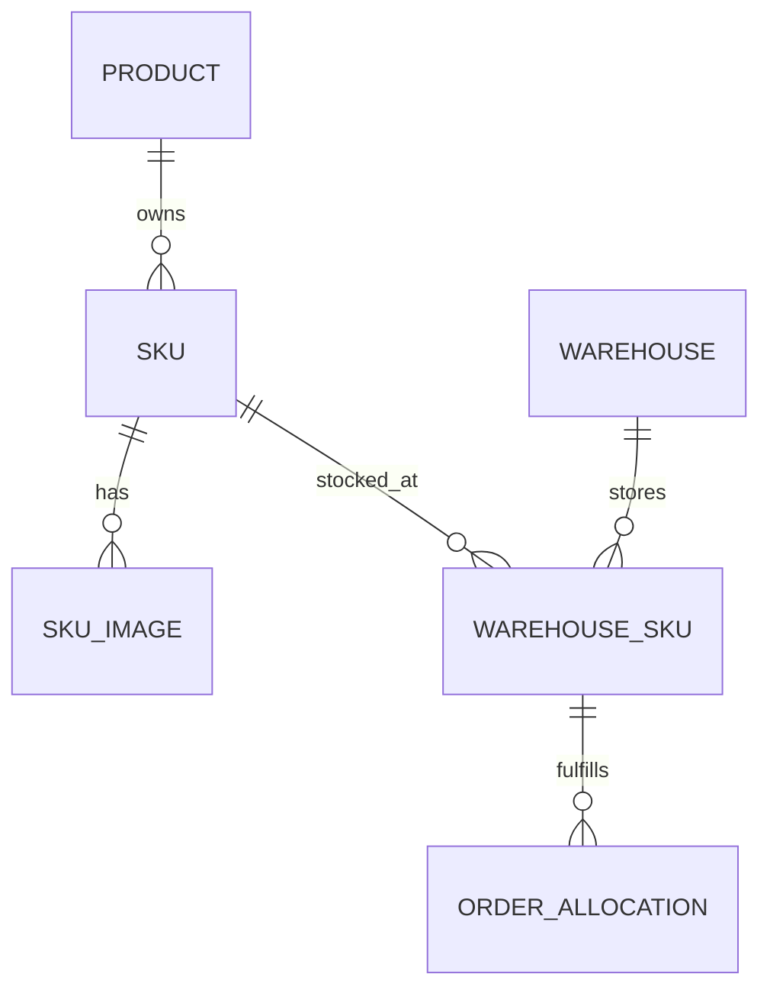

# Sản phẩm — SKU — kho — giá bán

Ngày kiểm chứng: 2026-11-09. Quy tắc được cửa hàng xác nhận: mỗi kho có giá SKU riêng, website tự chọn kho.

## Mô hình đã triển khai

- Một SKU có mã duy nhất không phân biệt hoa/thường và thuộc đúng một sản phẩm. Không chuyển SKU sang sản phẩm khác. Các sản phẩm có thể dùng cùng mẫu thuộc tính (ví dụ Độ tuổi), nhưng không dùng chung bản ghi hoặc mã SKU.
- Một sản phẩm có thể có 3 hoặc nhiều SKU. Mỗi SKU có ảnh được gán riêng. Ảnh chung của sản phẩm là fallback khi SKU chưa gán ảnh. API và khóa ngoại kiểm tra ảnh không gán nhầm SKU thuộc sản phẩm khác.
- Mỗi cặp **kho + SKU** có tồn thực tế, lượng giữ cho đơn, giá bán, giá trước giảm và phiên bản độc lập. Cùng SKU ở hai kho được phép có hai mức giá. Ảnh vẫn thuộc SKU, không nhân đôi SKU khi thêm kho.
- Giá trên màn Sản phẩm/SKU là **giá mặc định cho kho mới**. Dữ liệu cũ ban đầu kế thừa giá này; sau khi đặt giá tại kho, giá kho độc lập và không bị ghi đè khi sửa giá mặc định.

## Thao tác trong Admin

1. **Sản phẩm cha & SKU**: tạo sản phẩm, thêm các SKU có mã riêng. Tại Hình ảnh, tải ảnh lên, chọn ảnh và gán đúng mã SKU ở ô “Ảnh dùng cho”, rồi Lưu gallery. Mỗi thẻ SKU hiển thị ảnh riêng đã gán.
2. **Quản lý nhiều kho**: tạo kho hoặc chọn kho hiện có. Chọn sản phẩm trước, sau đó danh sách SKU chỉ hiện SKU thuộc sản phẩm đó. Thêm hàng với tồn và giá tại kho.
3. **Sửa tồn / giá**: chọn Kiểm kê để đặt tồn thực tế mới, hoặc Nhập thêm để cộng số lượng nhận. Chế độ nhập thêm yêu cầu nhập số lượng mới; không tự cộng số tồn đang hiển thị. Mỗi lần thay đổi cần lý do/chứng từ.
4. Chỉ xem số đang giữ, không sửa tùy ý. Không giảm tồn thấp hơn lượng đang giữ cho đơn. Nếu có người khác vừa sửa/đặt hàng, phiên bản cũ bị từ chối, cần tải lại.
5. **Xóa khỏi kho**: xóa một SKU, hoặc mở “Xóa toàn bộ một sản phẩm khỏi kho này” để xóa tất cả SKU của sản phẩm tại kho đang chọn. Tồn tại kho khác được giữ nguyên. Toàn bộ thay đổi trong một transaction, có xác nhận, lý do và nhật ký.
6. **Xóa sản phẩm & tồn các kho** trong trình sửa sản phẩm: dọn toàn bộ số dư kho của các SKU, loại khỏi catalog/giỏ lưu, ghi xuất điều chỉnh để sổ tồn cân bằng. Chặn nếu đang giữ hàng cho đơn hoặc có yêu cầu đổi trả chưa hoàn tất.

**Xóa sản phẩm là xóa khỏi hoạt động bán hàng, không xóa sổ sách lịch sử.** Bản ghi định danh sản phẩm/SKU được đánh dấu đã xóa và ngừng bán để đơn cũ, ảnh đơn, thanh toán, nhật ký và phiếu kho còn tham chiếu đúng. Không tái dùng mã SKU đã xóa. Phiếu nhập cũ không thể đưa SKU đã xóa trở lại kho. Chưa có nút khôi phục sản phẩm đã xóa; hàng đã bán còn khả năng đổi trả nên ưu tiên ngừng bán và xử lý hết đổi trả trước khi xóa.

## Website tự phân bổ

- Chỉ dùng kho loại bán hàng đang hoạt động; bỏ kho hư hỏng.
- Với từng SKU, lấy tồn khả dụng = tồn thực tế − đang giữ. Ưu tiên giá thấp trước; bằng giá thì ưu tiên mã kho nhỏ hơn để kết quả ổn định. Thiếu tại kho đầu thì lấy phần còn lại từ kho kế tiếp.
- Ví dụ 3 chiếc ở kho B giá 90.000đ và 1 chiếc ở kho A giá 100.000đ: tiền hàng cho 4 chiếc là **370.000đ**. Không áp 90.000đ hoặc giá SKU mặc định cho toàn bộ 4 chiếc.
- Khi nhiều mức giá còn hàng, thẻ hàng và trang chi tiết hiện “Từ …”. Giỏ hàng và thanh toán hiển thị các dòng số lượng × đơn giá và tổng đúng.
- Giữ tồn và tạo đơn dùng cùng phân bổ đã tính tại máy chủ. Khóa SKU/số dư kho ngăn bán vượt tồn. Báo giá có khóa kiểm chứng; nếu giá hoặc phân bổ đổi trước lúc gửi đơn, website cập nhật lại báo giá, giữ thông tin người nhận và yêu cầu khách kiểm tra lại.
- Đơn lưu riêng số lượng, giá, ảnh và kho xuất của từng phần. Đổi giá kho sau đó không sửa đơn cũ. Hoàn hàng tính được tổng lượng SKU đã mua kể cả khi đơn có nhiều dòng từ nhiều kho.

## Migration và bảo toàn dữ liệu

Migration mới `019_warehouse_catalog.sql`, không sửa migration đã phát hành. Bổ sung trường tombstone, giá kho, phiên bản số dư, snapshot kho trên dòng đơn và ràng buộc SKU/ảnh. Giá kho cũ được khởi tạo từ giá SKU hiện hữu; số lượng tồn và dữ liệu đơn cũ được giữ nguyên. Kiểm thử nâng cấp so sánh các cột dữ liệu lịch sử, kiểm tra checksum migration cũ và chạy migration lặp.

## Kiểm chứng

- `npm test`: 80 kiểm thử, gồm ca chuyên biệt `warehouse-catalog.test.mjs`.
- Ca chuyên biệt: 3 SKU/3 ảnh/giá/tồn độc lập, chặn dùng SKU chéo sản phẩm và trùng mã, chặn gán nhầm ảnh, nhiều giá theo kho, chia hàng và tính đúng tiền, báo giá cũ, idempotency, hai nhân viên sửa đồng thời, hai khách tranh lượng tồn cuối, chặn xóa khi giữ hàng/đổi trả, hoàn đủ lượng của SKU từ hai kho, xóa một kho không ảnh hưởng kho khác, xóa toàn sản phẩm dọn hết số dư và sổ tồn về đúng, đơn/ảnh cũ vẫn đọc được, phiếu cũ không hồi sinh tồn.
- `npm run test:warehouse`: tạo kho, chọn SKU đúng sản phẩm, sửa/nhập thêm tồn và giá, hủy/xóa sản phẩm khỏi kho, đổi cả 3 SKU kiểm tra ảnh/giá. 320/375/768/1440/1920px, không tràn ngang, đã xem ảnh trong `docs/screenshots/warehouse-catalog/`.
- `test:commerce`: 13; `test:management`: 11; `test:usability`: 9; `test:admin-access`: 6.
- `test:browser`: 14; `test:frontend-v3`: 12.

## Giới hạn và thông tin có thể bổ sung sau

- “Phù hợp” hiện được xác định theo giá và tồn; chưa chọn kho theo khoảng cách/địa chỉ, phí ship từng kiện hay thời gian giao. Muốn tối ưu địa lý cần địa chỉ kho, vùng phục vụ, ưu tiên và hợp đồng vận chuyển. Phí giao hàng vẫn theo chính sách hiện có, không tự nhân phí theo số kho.
- Chưa quản lý lô/hạn dùng, vị trí kệ hoặc giá vốn/giá nhập. Giá tại kho trong bản này là **giá bán**, không phải giá vốn. Cần mô tả thêm nếu cửa hàng dùng các nghiệp vụ đó.
- Kho có thể tạo và sửa tên. Chưa cung cấp xóa hẳn kho hoặc đổi loại kho đã tạo để không làm mất tham chiếu sổ sách; sản phẩm/SKU trong từng kho đã có thao tác xóa.
- Bộ chọn hiện tải danh sách SKU hiện hữu để chọn theo sản phẩm; phân trang/tìm SKU tại server cho catalog rất lớn là cải tiến hiệu năng tiếp theo.

## Cập nhật máy local

Trong thư mục repo: `git pull --ff-only origin main`, rồi `npm run local:start` để build lại. Ứng dụng tự áp migration khi khởi động. Mở `/quan-tri`, Ctrl+F5, vào **Quản lý nhiều kho**. Không xóa database/volume để cập nhật. Chỉ push source, chưa tự triển khai máy chủ cửa hàng.
